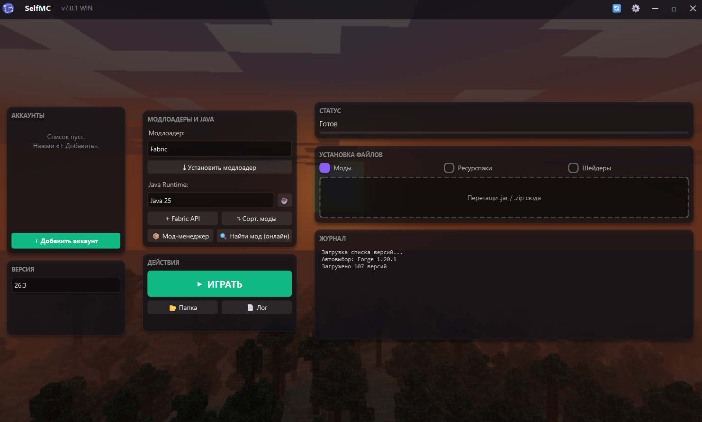
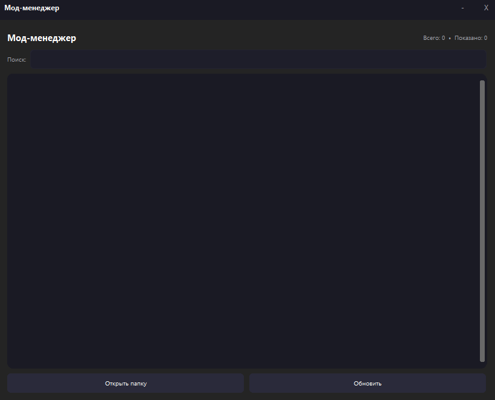
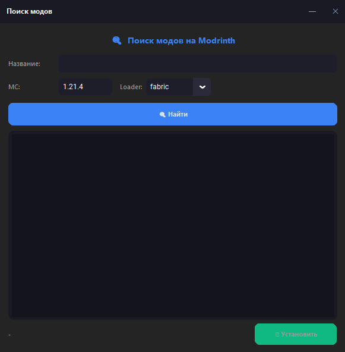
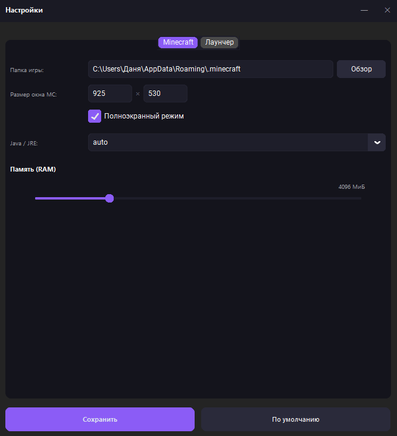

# SelfMC

**Современный лаунчер Minecraft для Windows на PySide6 с мод-менеджером, автообновлением и приятным интерфейсом**

🚀 Установка • ✨ Возможности • 📸 Скриншоты • 🛠 Разработка • ❓ FAQ • 📄 Лицензия

---

## 🎯 Что такое SelfMC?

**SelfMC** — это лёгкий лаунчер Minecraft для Windows, написанный на **Python 3.12** с интерфейсом на **PySide6 (Qt)**. Он создан для тех, кто устал от громоздких решений и хочет получить всё необходимое в одном месте: установку модлоадеров в один клик, поиск и установку модов, автообновление и приятный глазу интерфейс.

> 💡 **Почему SelfMC?** Потому что остальные лаунчеры либо перегружены, либо не работают на Windows «из коробки». SelfMC — лёгкий, нативный, и делает ровно то, что нужно.

---

## ✨ Возможности

### 🎨 Интерфейс
- 🌌 Тёмная тема с кастомным фоном и скруглёнными элементами
- 🖼 Смена фонового изображения в настройках
- 🌐 Три языка интерфейса: **RU / EN / UA**
- 🎯 Нативная интеграция с Windows (frameless-окно, ярлыки, установщик Inno Setup)

### ⚙️ Управление версиями
- 🚀 Установка **Fabric / Forge / NeoForge / Quilt**
- ☕ Автоматическая загрузка **Java Runtime** (jre-legacy, alpha, gamma, delta, epsilon)
- 📋 Список установленных и доступных версий, установленные подсвечиваются серым
- 🔍 Умный поиск и сортировка версий, автовыбор последней запущенной
- 🧠 Автовыбор нужной Java под версию Minecraft

### 📦 Моды
- 📦 **Мод-менеджер** с включением/выключением и удалением модов
- 🔍 Поиск модов на **Modrinth** прямо из лаунчера
- 🗂 Сортировка модов по версии Minecraft (`mods_sorted/`)
- 🎯 **Drag & Drop** модов, ресурспаков и шейдеров
- ➕ Установка **Fabric API** в один клик

### 🔧 Технические
- 🔄 **Автообновление** через GitHub Releases (с поддержкой бета-версий)
- 🌍 Поддержка зеркала **BMCLAPI** для СНГ
- ⚙️ Прокси для обхода блокировок
- 🎮 **Discord Rich Presence**
- 🛡 Защита от двойного запуска (single instance lock)
- 📄 Журнал в реальном времени, включая логи Minecraft

---

## 📸 Скриншоты

### 🖥 Главное окно

### 📦 Мод-менеджер

### 🔍 Поиск модов

### ⚙️ Настройки

---

## 🚀 Установка

### 🪟 Windows (10/11)

1. Скачай **`SelfMC-Setup-x.x.x-x64.exe`** из [последнего релиза](https://github.com/daanilll/SelfMC/releases/latest).
2. Запусти установщик и следуй инструкциям мастера.
3. После установки запусти **SelfMC** из меню «Пуск» или с рабочего стола.

**Требования:**
- Windows 10/11 (64-bit)
- 4 ГБ RAM (рекомендуется 8 ГБ+)

**Примечание:** Windows SmartScreen может показать предупреждение при первом запуске — это нормально для новых программ. Нажми «Подробнее» → «Всё равно запустить».

### 🛠 Установка из исходников

bash
# Установи зависимости (нужен Python 3.12)
pip install PySide6 minecraft_launcher_lib requests certifi pillow pypresence

# Запусти
python main_pyside.py

📋 Требования
Компонент	Минимум	Рекомендуется
ОС	Windows 10 (64-bit)	Windows 11
Python (для сборки)	3.10	3.12+
RAM	4 ГБ	8 ГБ+
Место на диске	2 ГБ	10 ГБ+ (с модами)
🎮 Как пользоваться
1️⃣ Добавь аккаунт

Нажми «+ Добавить аккаунт» → введи ник (3–16 символов, латиница и цифры, минимум одна буква).
2️⃣ Выбор версии

Открой SelfMC → выбери версию в выпадающем списке (например, 1.21.4). Если версия не установлена, кнопка сменится на «⤓ УСТАНОВИТЬ».
3️⃣ Установка модлоадера

Выбери Fabric / Forge / NeoForge / Quilt → нажми «⤓ Установить модлоадер».
4️⃣ Установка модов

  Из Modrinth: кнопка «🔍 Найти мод» → введи название → «⤓ Установить»

  Локально: перетащи .jar прямо в окно SelfMC

  Вручную: положи .jar в %APPDATA%\.minecraft\mods\

5️⃣ Запуск

Жми большую зелёную кнопку «▶ ИГРАТЬ».
🛠 Разработка
Структура проекта
text

SelfMC/
├── main_pyside.py              # Основной файл лаунчера (PySide6)
├── get_version.py              # Чтение версии из кода
├── discord_rpc.py              # Discord Rich Presence (опционально)
├── black.ico                   # Иконка приложения
├── 08a7f786954d6af7ce56b1573bf72ee0.png  # Фоновое изображение по умолчанию
├── installer.iss               # Inno Setup скрипт
├── build.bat                   # Скрипт сборки
├── VERSION.txt                 # Кэш версии для сборки (генерируется)
├── docs/
│   ├── logo.png
│   └── screenshots/
└── README.md

Сборка .exe и установщика
bash

# Просто запусти build.bat
build.bat

Скрипт автоматически:

  Прочитает версию из main_pyside.py через get_version.py

  Соберёт SelfMC.exe через PyInstaller

  Создаст установщик через Inno Setup

  Результат появится в installer_output\

Версионирование

  Мелкая правка: 7.0.1 → 7.0.2 … 7.0.9

  Крупное обновление: 7.0.9 → 7.9.0

  Следующий мажор: 7.9.9 → 8.0.0

Важно: тег релиза на GitHub должен совпадать с числовой частью CURRENT_VERSION (без WIN), например 7.0.2. Суффикс WIN в коде допустим и отбрасывается парсером версий, но в теге он не нужен.
🤝 Вклад

  🐛 Нашёл баг? → Создай Issue

  💡 Есть идея? → Открой обсуждение

  📝 Pull Request — приветствуется

🗺 Дорожная карта

  ☑

   Базовый функционал
    ☑

  Установка Fabric / Forge / NeoForge / Quilt
    ☑

  Мод-менеджер
    ☑

   Поиск модов на Modrinth
    ☑

  Переход на PySide6
    ☑

   Автообновление через GitHub Releases
    ☑

   Discord Rich Presence
    ☑

  Три языка (RU / EN / UA)
    ☑

  Зеркало BMCLAPI и прокси
    ☑

   Менеджер модпаков (Modrinth Modpacks)
    □

  Менеджер аккаунтов со скинами
    □

  Поддержка CurseForge
    □

  Сборка для Linux (.deb / .rpm)

❓ FAQ

SelfMC не запускается, что делать?
Убедись, что установлен Python 3.12 (не 3.15). Если запускаешь из исходников:
bash

python -c "import PySide6, minecraft_launcher_lib, requests"

Если что-то падает — установи:
bash

pip install PySide6 minecraft_launcher_lib requests certifi pillow pypresence

Как обновить SelfMC?
Запусти — он сам проверит обновления. Или нажми 🔄 в топбаре.

Где хранятся настройки и логи?

   Настройки: %APPDATA%\SelfMC\settings.json

  Лог: %APPDATA%\SelfMC\last_run.log

   Игра: %APPDATA%\.minecraft\

Как включить/выключить Discord RPC?
Открой Настройки → Лаунчер → галочка «Discord Rich Presence».

Работает ли на Linux?
Пока нет. Проект ориентирован на Windows. В планах — сборка для Linux.

Что с CurseForge?
Поддержка CurseForge через API — в разработке.
📄 Лицензия

Этот проект распространяется под лицензией MIT. Подробности в файле LICENSE.
💖 Благодарности

  🎮 Mojang — за Minecraft

   🧵 Fabric / Forge / Quilt — за модлоадеры

  📦 Modrinth — за открытое API

  🐍 Python + PySide6 — за инструменты

  🎨 Сообщество — за поддержку

🌟 Понравился проект? Поставь звезду!

https://api.star-history.com/svg?repos=daanilll/SelfMC&type=Date

Сделано с ❤️ на Windows
